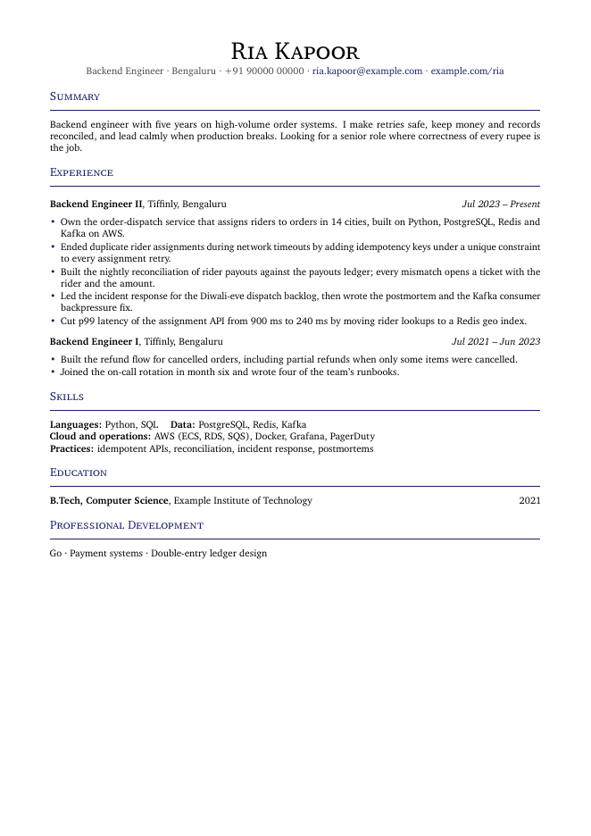
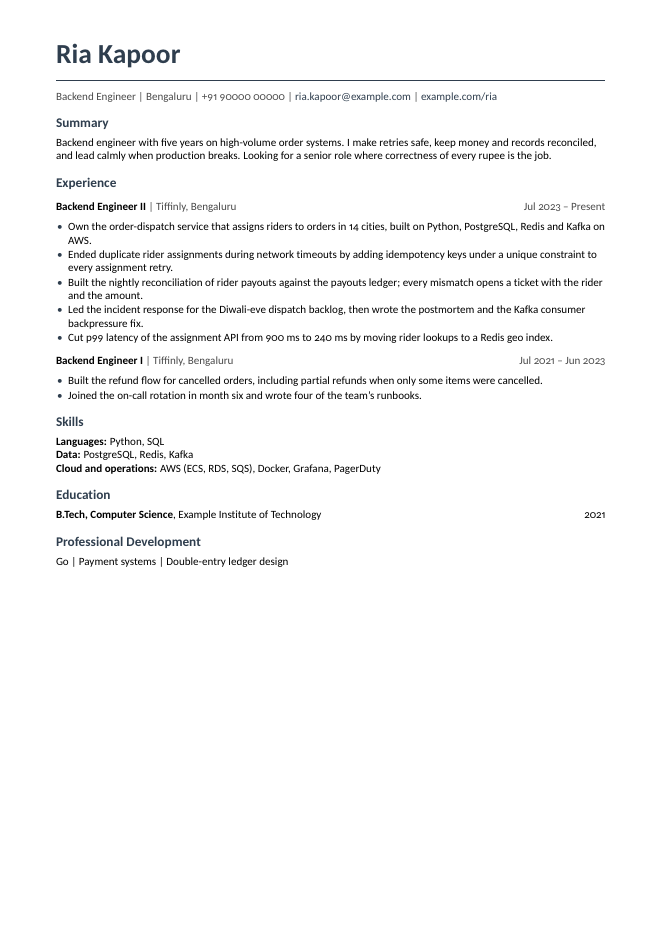
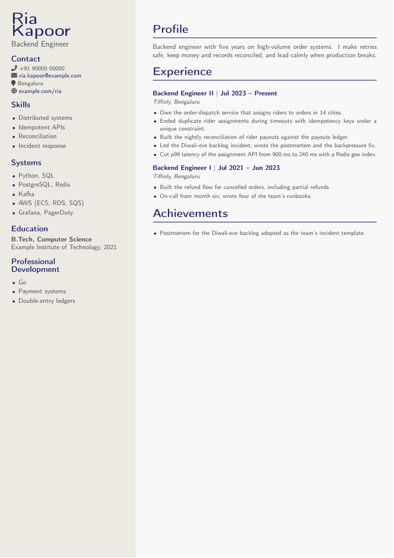

# Tailor-made resumes

A Claude Code skill that works like a paid personal resume tailor. You give it your resume and a job link. It gives you an interview cheat sheet and two resumes for that job, all built from facts you approved.

It is for anyone applying to jobs who wants each application tailored, without inventing anything and without learning LaTeX.

## What you get for each job

- **A two-page interview cheat sheet.** It explains what the job really is and walks the core metrics through one working day. It tells one story with worked numbers, gives interview answers with the reasoning shown, and ends with cold drills and questions to ask. Every point is tagged KNOW (you already do this, in their words), LEARN (new, taught on the sheet) or TRAP (the gotcha interviewers use to sort candidates).
- **A human resume.** One page, in one of three layouts.
- **An ATS resume.** One page, single column and keyword-rich, so applicant tracking systems (the software that screens online applications) read every word.

Everything comes from one fact file that you approve first. The skill never invents a metric, a duty or a certification.

See a complete fictional run before you install: [cheat sheet](examples/ria-kapoor/jobs/ledgerline-senior-backend-payments/cheatsheet.pdf), [topic cheat sheet](examples/ria-kapoor/topics/cheatsheet_ledgers.pdf), [human resume](examples/ria-kapoor/jobs/ledgerline-senior-backend-payments/human.pdf), [ATS resume](examples/ria-kapoor/jobs/ledgerline-senior-backend-payments/ats.pdf), and the [fact file](examples/ria-kapoor/profile/dossier.md) they came from.

## Install

You need [Claude Code](https://claude.com/claude-code) and Python 3.9 or later.

```bash
git clone https://github.com/luffy2095/tailor-made-resumes ~/.claude/skills/tailor-made-resumes
```

To update later:

```bash
git -C ~/.claude/skills/tailor-made-resumes pull
```

## How to use

### First run

Open Claude Code and say: `tailor my resume for this job: <link>`.

1. **Setup.** The skill installs TinyTeX, a small LaTeX distribution, into your user folder. It needs 300 to 420 MB depending on the OS, and no admin rights. On a fast connection it takes under a minute. This happens once.
2. **Your material.** It asks for your current resume as PDF or DOCX, or your LinkedIn profile saved as PDF. Portfolio and GitHub links help.
3. **Standard questions.** A few questions with ready options: your field, seniority, location, whether employer numbers are confidential, and your resume style. One open question comes last.
4. **Your fact file.** It asks a few follow-ups, then shows you a fact file with every role, tool and achievement. You correct it and approve it. Nothing is built before that.
5. **The job kit.** It reads the job post and shows you three lists: what you already do, what you need to learn, and what is missing. You adjust the lists. Then it builds the cheat sheet and both resumes and shows you previews.

### After that

| You say | It does |
|---|---|
| `tailor my resume for <link>` | Builds a new job kit from your fact file. |
| `make a cheat sheet on SQL for my interview` | Builds a topic cheat sheet, or reuses one you already have. |
| `I finished the Go course` | Updates your fact file, logs the change, and offers to rebuild open applications. |
| `I got promoted` | Asks about the new role only, then updates your fact file. |
| `change my resume style to modern` | Switches the layout for future resumes. |
| `what did I apply to?` | Shows your application log. |

## Where your files live

Your files stay on your computer, in `~/career` unless you choose another folder:

```
~/career/
  profile/    your fact file, its change log, and an optional photo
  jobs/       one folder per application, plus a log of what you sent
  topics/     topic cheat sheets you can reuse across jobs
```

The skill reads your resume inside your Claude Code session. It fetches job posts and checks reading links. It sends your files nowhere else.

## Layouts

The ATS resume always uses one fixed layout. For the human resume you pick one of three.

| Classic | Modern | Two-column |
|---|---|---|
|  |  |  |

A photo is possible in the two-column layout. JPG, PNG, AVIF, WebP and HEIC all work.

## Fields it knows

A track tells the skill which keywords recruiters in a field look for, which proof to ask you for, which layout suits the field, and what the cheat sheet should focus on.

| Track | Status |
|---|---|
| Software engineering | ready |
| Hospitality revenue management | ready |
| Marketing, finance, sales, product, data science | wanted: [propose one](https://github.com/luffy2095/tailor-made-resumes/issues/new?template=new_track.yml) |

Without a matching track, the skill still works. It uses general rules and asks you more questions.

## What the build checks

- Each document has its exact page count: two for a cheat sheet, one for a resume.
- No unfilled placeholder reaches a PDF.
- The ATS PDF's text has no ligature characters. A parser that reads "Office" as "O" plus one special glyph misses the keyword.
- Each job folder records which version of your fact file it was built from.

## Requirements

| OS | Status | Notes |
|---|---|---|
| macOS | tested | nothing extra |
| Linux | supported, untested | needs full `perl` (not perl-base) and `xz`. Setup names what is missing. |
| Windows | supported, untested | nothing extra. Setup runs TinyTeX's PowerShell installer itself. |

Optional: `pdftoppm` and `pdftotext` from poppler give PNG previews and the ATS text check (`brew install poppler` or `apt install poppler-utils`).

If you run it on Linux or Windows, please [report how it went](https://github.com/luffy2095/tailor-made-resumes/issues/new?template=bug_report.yml), even when it works.

## Suggest a feature or report a bug

- **Idea or request:** [open a feature request](https://github.com/luffy2095/tailor-made-resumes/issues/new?template=feature_request.yml).
- **A field you want supported:** [propose a track](https://github.com/luffy2095/tailor-made-resumes/issues/new?template=new_track.yml).
- **Something broke:** [report a bug](https://github.com/luffy2095/tailor-made-resumes/issues/new?template=bug_report.yml).

Never paste your real resume, fact file or personal details into an issue.

## Contribute

Contributions are welcome, and new tracks help most. [CONTRIBUTING.md](CONTRIBUTING.md) explains how to set up, how to add a track or a layout, and how to test with one command.

## Licence

MIT. See [LICENSE](LICENSE).
